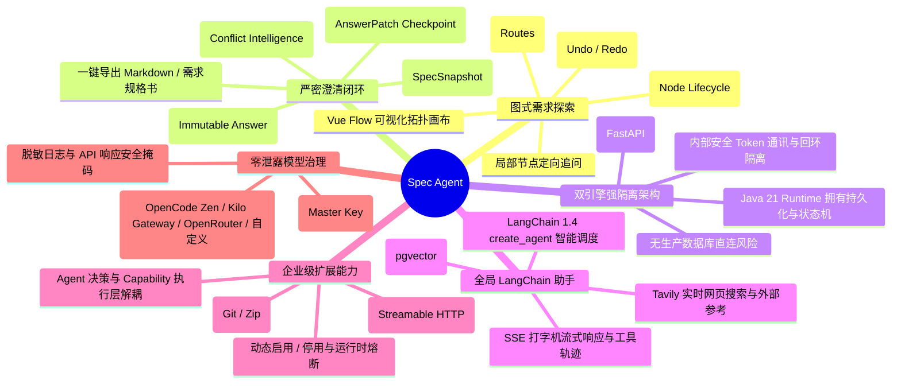
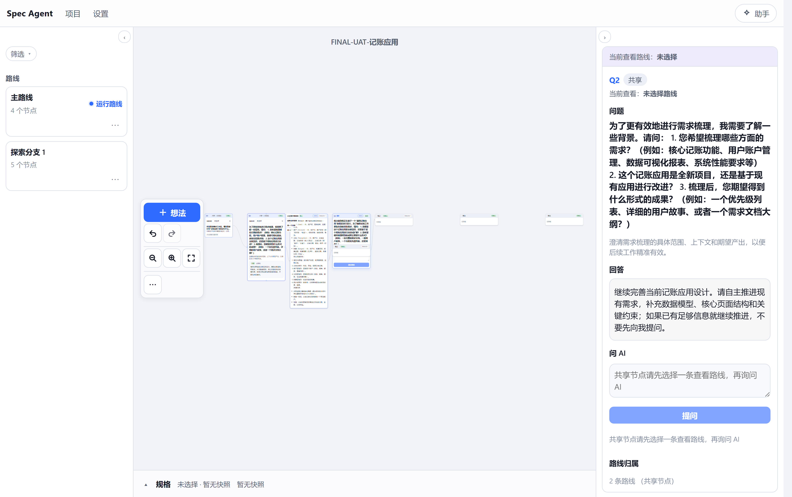
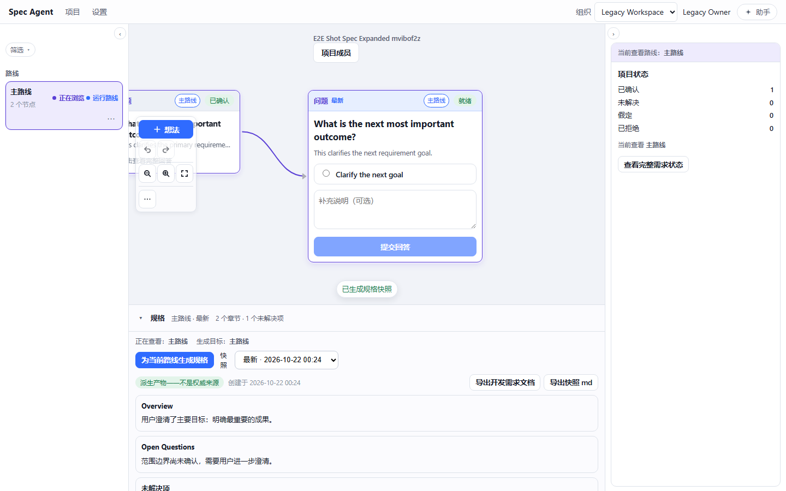
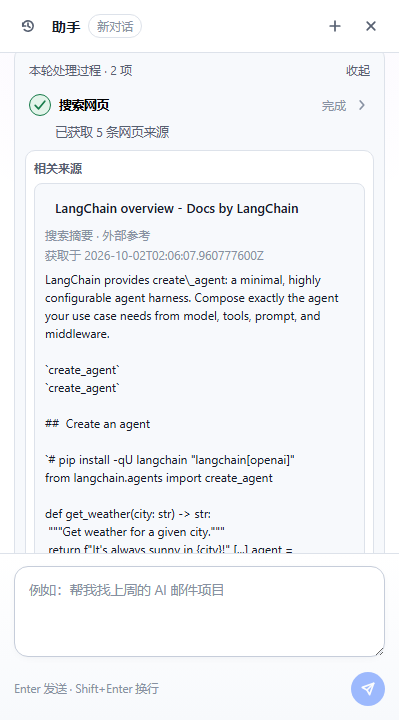
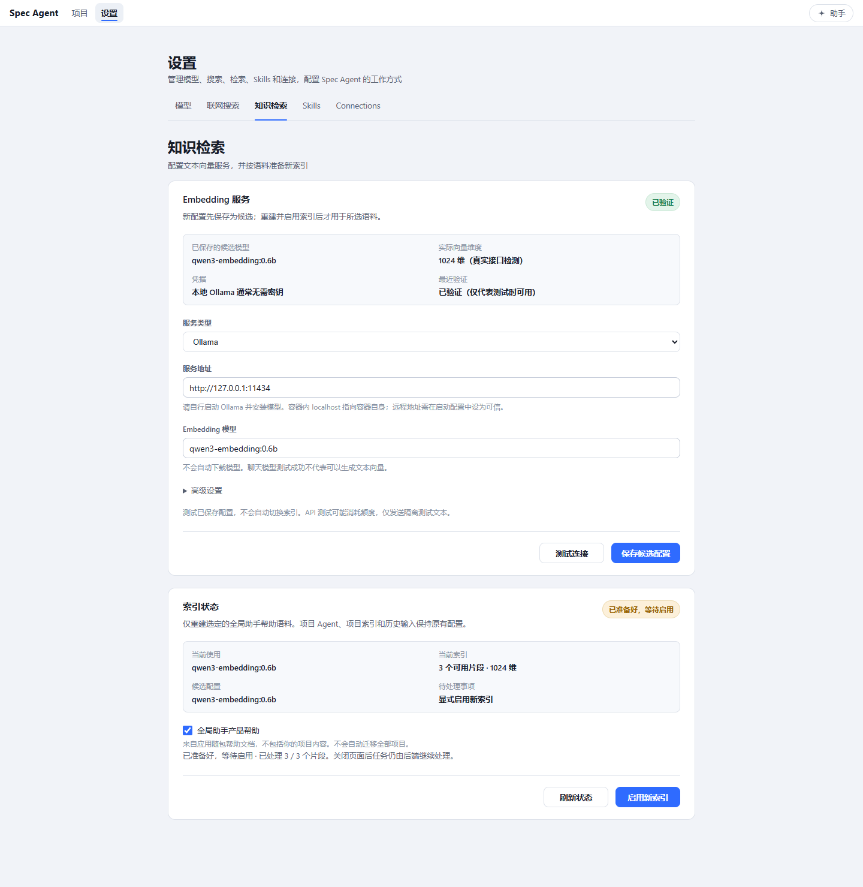
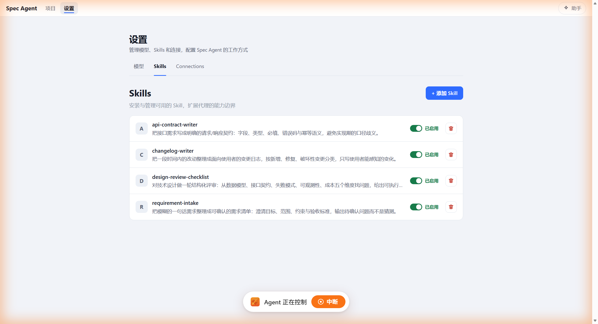
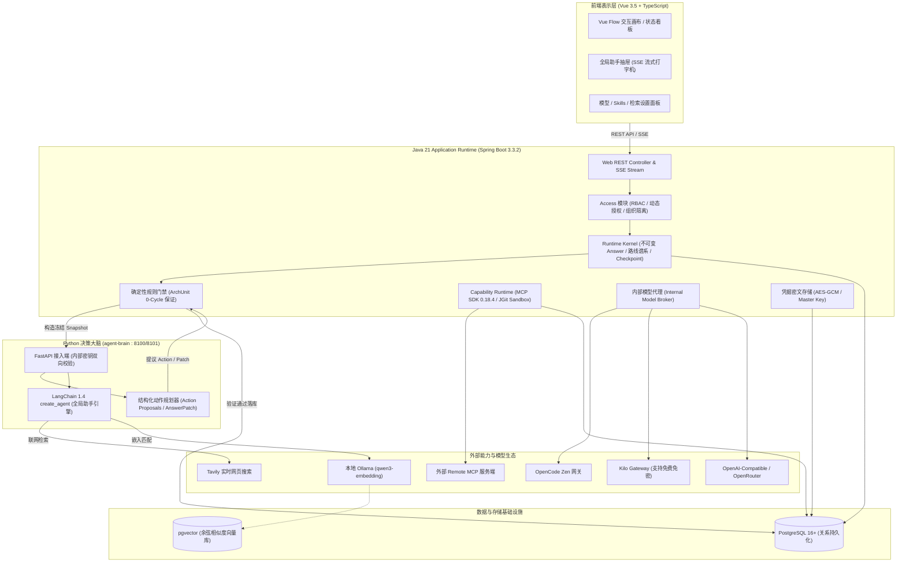
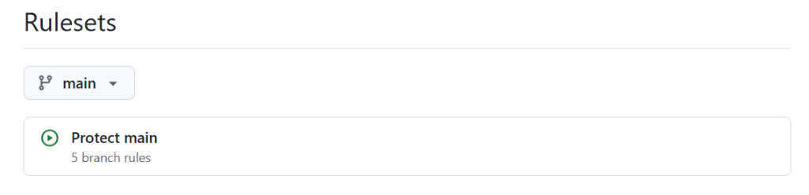

<div align="center">

# Spec Agent

### 面向复杂需求澄清与规格沉淀的图式 AI 知识工作台

<p align="center">
  <a href="https://github.com/BangShou1st/spec-agent/actions">
    
  </a>
  
  
  
  
  
  
  
  
  
  
  
</p>

<p align="center">
  <b>Graph 驱动需求探索 · 不可变历史回溯 · 双引擎强隔离 · 确定性规则门禁 · 全局 LangChain 助手 · 企业级 MCP/Skill 扩展</b>
</p>

---

[功能特性](#-功能特性) • [系统架构](#-系统架构) • [界面全景](#-界面全景) • [核心设计原则](#-核心设计原则) • [技术栈](#-技术栈) • [项目结构](#-项目结构) • [快速开始](#-快速开始) • [AI 模型与凭据安全](#-ai-模型与凭据安全) • [分支规范与 Ruleset 保护](#-分支规范与-ruleset-保护) • [测试与质量门禁](#-测试与质量门禁)

</div>

<br />

## 📖 项目简介

在现代敏捷研发与系统架构设计中，需求不明确或规格频繁漂移是导致项目延期和返工的首要诱因。传统大模型辅助方案往往存在以下致命短板：

* **上下文漂移与幻觉累积**：线性聊天模式将整个历史塞入 Prompt，长文本不仅引发注意力衰减，更容易导致模型产生脱离业务事实的幻觉。
* **事实缺乏溯源与审计**：生成的 PRD 或需求文档缺少可机器校验的论据支撑，无法反查某条业务规则是根据哪个回答、何种背景得出的。
* **无法安全分支与回滚**：探索替代方案时直接覆盖历史记录；历史回答一旦修改，全链路状态失真，无法做轻量化的假设与路线回溯。
* **黑盒自主失控**：Agent 自主无限循环执行外部副作用，缺乏人机断点与严格的执行凭证管控。

**Spec Agent** 重新定义了需求工程的协作范式。它不是一个单向问答的聊天机器人，而是一个**面向复杂需求澄清与规格沉淀的图式 AI 知识工作台**。

通过**图式工作区（Graph Workspace）**，用户与 Agent 共同探索、记录、确认、质疑和演进需求。系统通过**不可变回答（Immutable Answers）**、**谱系隔离回放（Lineage Replay）**、**细粒度修补检查点（AnswerPatch Checkpoints）**与**确定性门禁（Deterministic Gates）**，将散乱模糊的初步构想，逐步沉淀为**高可信、可追溯、可恢复、可验证**的工程规格资产。

> 核心铁律：
> **Model proposes. Runtime validates. Runtime persists. Runtime owns history.**  
> （模型负责推理与提议，Runtime 负责约束、验证、持久化与掌握历史。）

---

## ✨ 功能特性



### 1. 🎯 图式工作区与多路线探索 (Graph Workspace)
* **可视化交互画布**：基于 Vue Flow 打造的高性能工作台，支持节点的自由布局、缩放、拖拽与平移。
* **多路线分叉与隔离（Routes & Lineage）**：支持从任意历史节点开辟新探索分支。不同路线独立演进，上下文严格按父系谱系（Lineage）重放，互不污染。
* **节点全生命周期（Workspace Units）**：节点不再局限于“问题”，支持想法、确认项、设计决策等多种交互单元。
* **撤销与重做（Undo / Redo）**：完备的操作历史堆栈，画布结构与交互均可安全回退。

### 2. 🛡️ 确定性需求闭环与可追溯规格 (Deterministic Clarification)
* **不可变回答（Immutable Answers）**：历史回答绝不原地覆盖。修改回答自动触发新修订版本或路线分叉，保留完整决策轨迹。
* **细粒度状态更新（AnswerPatch Checkpoints）**：Agent 对回答进行 Claim、Constraint、Assumption、Risk、Conflict 等结构化解析并形成 Checkpoint。
* **冲突检测与干预（Conflict Intelligence）**：自动识别前置假设与最新回答之间的语义冲突，引导用户做决策裁决。
* **带源引用的派生规格（Grounded SpecSnapshot）**：规格快照属于派生产物，每个论点精准回溯到具体的 Node、Answer 和 Patch。未解决的冲突严格阻断规格生成。

### 3. 🧩 双引擎分离架构 (Dual-Engine Architecture)
* **Java 21 Runtime**：负责组织/项目 RBAC 权限、状态机驱动、路线隔离、数据落库与确定性规则校验。后端保持 **0 Package Cycle** 的 ArchUnit 严苛架构门禁。
* **Python Agent Brain**：基于 FastAPI + LangChain 构建的无状态决策引擎。专注于逻辑分析、结构化动作提议（Action Proposal），**严禁直接访问生产数据库**。
* **内部通信隔离**：基于动态生成的随机内部密钥与回环地址（127.0.0.1）通信，防止外部未授权侧信道访问。

### 4. 🌐 全局 LangChain 助手 (Global Assistant)
* **LangChain 单引擎编排**：内置全局助手抽屉，使用 LangChain `create_agent` 实现全流程动态工具调度。
* **联网检索（Tavily Web Search）**：支持联网实时检索前沿技术方案与外部最佳实践，并在回复中自动列出参考来源。
* **本地 RAG 知识检索（pgvector + Ollama）**：支持本地嵌入模型（如 `qwen3-embedding`）与兼容向量接口，提供毫秒级知识库匹配与产品帮助检索。
* **实时流式与轨迹审计**：Server-Sent Events (SSE) 逐字输出打字机体验，清晰展示“思考过程”、“工具调用”与“最终结论”。

### 5. 🔌 扩展能力生态 (Skills & MCP SDK)
* **Model Context Protocol (MCP)**：集成官方 MCP Java SDK（版本 0.18.4），通过 Remote Streamable HTTP 协议无缝接入外部 MCP Server 工具。
* **安全 Skill 导入**：支持从 Git 仓库或 Zip 压缩包一键导入业务 Skill。底层采用 Eclipse JGit 纯 Java 客户端，不运行系统 git hook、不加载软链接，保证沙箱环境安全。
* **职责彻底解耦**：Agent 决定“做什么（What）”，Capability Runtime 决定“怎么做（How）”。

### 6. 🔐 企业级模型治理与安全加密 (Model Gateway & Security)
* **AES-GCM 密文落库**：所有大模型 API Key 在入库前均经过 AES-GCM 高强度加密，日志脱敏且 API 响应只返回安全掩码。
* **支持主密钥轮换**：提供环境变量与持久化主密钥双轨支持，平滑兼容密钥轮换（Fallback Key）与重启自检。
* **多 Provider 原生接入**：开箱即用支持 OpenCode Zen、Kilo Gateway（含免费免密接入）、OpenRouter、本地 Ollama 以及任何标准 OpenAI-Compatible 兼容端点。

---

## 🖼️ 界面全景

<div align="center">

### 1. 图式需求探索工作区 (Graph Canvas Workspace)
*多路线树状分叉、节点连线拓扑、交互式澄清问答与右侧实时状态统计*
<br /><br />


<br /><br />

### 2. 派生规格快照与导出 (Derived Spec & Markdown Export)
*路线维度一键生成规格、未决项预警、完整论据溯源以及工程级 Markdown 导出*
<br /><br />


<br /><br />

### 3. 全局 LangChain 助手与联网检索 (Global Assistant with Web Search)
*基于 LangChain create_agent 驱动的抽屉式会话，内置 Tavily 网页搜索与实时引用展开*
<br /><br />


<br /><br />

### 4. 向量检索与本地 Embedding 设置 (Knowledge Retrieval & Vector Engine)
*深度适配本地 Ollama 嵌入模型与兼容 Embeddings API，实时维度自适应与索引重建*
<br /><br />


<br /><br />

### 5. Skills 与 MCP 能力中心 (Skills & Capability Management)
*接口契约生成、变更日志、设计评审等企业级 Skill 扩展与运行时控制*
<br /><br />


</div>

---

## 🏛️ 核心设计原则

Spec Agent 严格遵守并贯彻以下核心工程不变量（Core Invariants）：

| 原则 | 含义与保障机制 |
|---|---|
| **Graph 是唯一真相源** | 需求演进的真实状态由 Node、Route、Answer、Snapshot 共同构成，而非一段线性的聊天记录。 |
| **Model Proposes, Runtime Validates** | 模型仅能返回结构化的 Action Proposal（动作提议）；只有通过 Runtime 的白名单策略与前置门禁后，才允许落库生效。 |
| **不可变追加式历史 (Append-Preserving)** | 历史回答与既有路线禁止原地修改。探索新假设通过分叉（Fork Route）推进；重答问题通过版本修订推进。 |
| **谱系上下文 (Lineage, Not History)** | 上下文通过从活跃路线的 Tip 向上追溯父系构建。同级路线（Sibling Routes）、废弃路线（Superseded）严格隔离。 |
| **派生产物带来源引用 (Source Grounding)** | 导出的规格说明书必须附带数据来源。没有用户回答或确认记录支撑的论点，只能被标记为“未决假设”或“风险”。 |
| **顾问模式优先 (Advisor by Default)** | 涉及破坏性变更、外部副作用或已确认意图变更时，系统强制要求用户显式确认，拒绝 Agent 危险自循环。 |
| **双引擎职责硬隔离** | Java Runtime 独占数据库连接与状态持久化；Python Brain 专心负责模型推理与结构化决策。 |

---

## 🏗️ 系统架构

系统的分层交互拓扑如下：



---

## 💻 技术栈

| 领域 | 技术选型 | 版本 | 核心作用与定位 |
|---|---|---|---|
| **后端语言** | Java | 21 (LTS) | 核心业务架构与确定性运行时基石 |
| **应用框架** | Spring Boot | 3.3.2 | 生产级 API 网关、依赖注入与模块化生命周期 |
| **会话与安全** | Spring Security / Session | 6.x | RBAC 权限判定、基于 JDBC 的分布式共享会话 |
| **数据库** | PostgreSQL + pgvector | 16 / 17 | 关系型不可变事实存储、向量语义嵌入与余弦检索 |
| **架构防线** | ArchUnit | 1.4.0 | 强行约束 **0 Package Cycle**，严防模块循环依赖 |
| **协议与工具** | Model Context Protocol (MCP) | 0.18.4 | 官方 Java SDK，支持标准 Remote Streamable HTTP MCP 协议 |
| **沙箱 Git** | Eclipse JGit | 7.8.0 | 纯 Java 实现，免 Hooks/免软链接的安全 Skill 导入沙箱 |
| **决策大脑** | Python | >= 3.11 | 无状态结构化推理与 Agent 智能体核心引擎 |
| **大脑框架** | FastAPI + Uvicorn | 0.110+ | 高性能异步轻量级服务接入层 |
| **Agent 编排** | LangChain / LangGraph | 1.4.3 / 1.2.12 | 全局助手动态 Tool Calling、状态图与工作流管理 |
| **前端框架** | Vue | 3.5.13 | 现代化响应式前端视图与组件驱动 |
| **前端语言** | TypeScript | 5.8.3 | 强类型契约校验与严格编译期检查 |
| **图拓扑渲染** | Vue Flow | 1.48.2 | 工业级可扩展有向图拓扑交互画布与拖拽流转 |
| **状态管理** | Pinia | 2.3.1 | 高内聚的前端模块切片式全局状态中心 |
| **构建与测试** | Vite / Vitest / Playwright | 6.x / 4.x / 1.62+ | 秒级 HMR、高覆盖组件测试与全链路真实浏览器端到端验收 |

---

## 📂 项目结构

```text
spec-agent/
├── backend/                         # Java 21 + Spring Boot 模块化单体工程
│   ├── src/main/java/com/specagent/
│   │   ├── access/                  # 组织/项目双层 RBAC 权限体系、ActorContext 授权守卫
│   │   ├── agent/                   # Agent 执行状态机、Stage A–D 运行流、C16 等待与冲突裁决
│   │   ├── assistant/               # 全局 LangChain 助手服务桥接、会话生命周期
│   │   ├── capability/              # Capability Runtime、Skill 导入解析与调度
│   │   ├── connection/              # MCP 远程连接配置与连接池管理
│   │   ├── mcp/                     # 官方 MCP Java SDK 隔离适配层
│   │   ├── model/                   # 多厂商模型网关（OpenCode Zen / Kilo Gateway / OpenRouter 等）
│   │   ├── modelsettings/           # API Key 的 AES-GCM 密文落库与 Master Key 轮换
│   │   ├── retrieval/               # 统一 RAG 检索流水线、Ollama 向量自适应接入
│   │   ├── runtime/                 # 确定性 Runtime Kernel、不可变 Answer、路线谱系隔离
│   │   ├── skill/                   # JGit 纯 Java 安全沙箱导入与白名单校验
│   │   ├── web/                     # 严格类型化的 REST 控制器与 SSE 打字机通道
│   │   └── workspace/               # 项目生命周期、图式节点模型（Workspace Units）
│   └── src/test/                    # 完整单元测试、ArchUnit 架构门禁与集成测试套件
├── agent-brain/                     # Python 3.11+ Agent 决策大脑
│   ├── src/spec_agent_brain/
│   │   ├── app.py                   # FastAPI 接入端，提供结构化推理与健康检查
│   │   ├── assistant/               # LangChain create_agent 全局助手实现
│   │   ├── tools/                   # Tavily 实时网页搜索与本地 Ollama 检索工具
│   │   └── engine/                  # 结构化 Action Proposal 规划引擎
│   └── tests/                       # 确定性 pytest 契约测试集
├── frontend/                        # Vue 3.5 + TypeScript + Vite 前端工程
│   ├── src/
│   │   ├── features/
│   │   │   ├── workspace/           # Vue Flow 图式工作台、节点定制组件与连线拓扑
│   │   │   ├── global-assistant/    # 抽屉式全局助手、SSE 打字机解析器
│   │   │   ├── skills/              # Skill 管理、导入与状态开关面板
│   │   │   ├── connections/         # MCP 服务端接入与连接探测配置
│   │   │   ├── service-settings/    # 知识检索与本地向量模型设置
│   │   │   ├── model-settings/      # 多厂商模型凭据配置与测试联通
│   │   │   └── access/              # 组织与成员角色权限管理面板
│   │   └── shared/                  # 通用 UI 组件与网络拦截器
│   └── tests/                       # Vitest 交互测试与 Playwright E2E 测试
├── contracts/                       # Java ↔ Python 共享的 JSON Schema 强类型契约
├── docs/                            # 完备的技术架构、设计演进与实施规范文档
│   └── v2/                          # V2 权威 Canonical 设计规约（核心基线）
├── assets/                          # 界面高清效果图、架构图与规则保护证据
├── start-dev.bat                    # Windows 本地开发一键启停总入口
├── docker-compose.yml               # 本地基础设施容器编排（PostgreSQL 5434）
└── AGENTS.md                        # AI 编码助手必须严格遵守的工程铁律
```

---

## 🚀 快速开始

### 1. 环境准备

确保您的本地开发机已准备好以下环境依赖：

* **Java**：JDK 21 或更高版本
* **Node.js**：>= 20.x（推荐 LTS）
* **Python**：>= 3.11
* **Docker**：Docker Desktop（用于启动本地隔离的 PostgreSQL 数据库）

### 2. 推荐方式：Windows 本地一键启动

仓库根目录提供了全自动化的一键启停脚本 `start-dev.bat`。它会自动检测冲突端口、回收历史进程、生成独立随机通信密钥，并依次拉起整个全栈服务：

```bat
# 启动前端 + 后端 + Python Agent 大脑
start-dev.bat

# 可选参数：跳过 Python 大脑（仅离线开发模式）
start-dev.bat --no-brain
```

脚本将智能配置好以下服务：

| 组件 | 本地地址 | 职责说明 |
|---|---|---|
| **前端应用 (Vite HMR)** | `http://localhost:5173` | 基于 Vue Flow 的图式交互工作台 |
| **后端 API (Spring Boot)** | `http://localhost:8080` | 控制面与业务 Runtime（端口占用时自动顺延） |
| **Python Brain (Uvicorn)** | `http://127.0.0.1:8100` | 项目 Agent 决策大脑服务 |
| **全局助手 Brain** | `http://127.0.0.1:8101` | 基于 LangChain 的独立全局助手服务 |

---

### 3. 分组件手动启动

如需单独调试某个模块，可按如下步骤手动分步运行：

#### ① 启动基础设施 (PostgreSQL)
```bash
docker compose up -d
```
> 默认在 `127.0.0.1:5434` 建立专属开发库（账号/密码：`spec_agent` / `spec_agent_dev`，数据库名：`spec_agent`）。严禁将业务库与测试库混用。

#### ② 启动 Python Agent 大脑
```bash
cd agent-brain

# 创建并激活隔离虚拟环境
python -m venv .venv
# Windows PowerShell
.venv\Scripts\Activate.ps1
# 安装开发与运行依赖
pip install -e ".[dev]"

# 启动大脑服务（支持 fake 确定性模式与 broker 真实模式）
uvicorn spec_agent_brain.app:app --host 127.0.0.1 --port 8100
```

#### ③ 启动 Java 后端
```bash
cd backend
# Windows
.\gradlew.bat bootRun
# Linux / macOS
./gradlew bootRun
```

#### ④ 启动 Vue 前端
```bash
cd frontend
npm install
npm run dev
```

---

## ⚙️ AI 模型与凭据安全

Spec Agent 严格遵守企业级“数据不落地、凭据不外泄、单用户回环交付”的安全准则：

### 1. AES-GCM 凭据高强度落库
* 所有供应商 API Key 在写入 PostgreSQL 之前均经由 **AES-GCM** 算法加密（密文格式标记为 `enc:v1:<keyId>:...`）。
* 系统所有对外 REST API、日志打印、全链路 Trace 均做脱敏过滤，仅输出掩码后缀，杜绝外泄风险。

### 2. 主密钥（Master Key）多层解析与轮换
1. 优先读取环境变量 `SPEC_AGENT_SECRET_MASTER_KEY`（32 字节 Base64 编码）。
2. 未配置时，首次启动自动在 `backend/data/secret-master.key` 生成本机唯一密钥文件。
3. **安全轮换**：若需更换密钥，将新密钥作为主密钥，旧密钥配置到 `SPEC_AGENT_SECRET_MASTER_KEY_FALLBACK`，重启一次即可全自动完成密文重加密。

### 3. 支持的模型接入方式
* **OpenCode Zen**：官方合作高性能推理通道，内置专有 User-Agent 标头与容灾机制。
* **Kilo Gateway**：支持免费免密直连使用开源顶尖模型。
* **OpenRouter & 自定义兼容 API**：全面支持任何 OpenAI-Compatible 协议接口（如 DeepSeek、Qwen、Claude、GPT 等）。
* **本地 Ollama 嵌入服务**：知识库与全局助手可直连本地 Ollama（如 `qwen3-embedding:0.6b`），实现 100% 离线、私有化的文档切块与向量召回。
* **Tavily Web Search**：配置 Tavily 密钥后一键开启全局助手的实时网络探索与资料搜集。

---

## 🌿 分支规范与 Ruleset 保护

为了保证主干分支的生产可用性、可追溯性与代码防污染，本项目严格执行分支保护策略与开发流水线：

<div align="center">
  
  <p><i>GitHub 仓库受保护主干配置：Protect main（5 项严苛分支规则约束）</i></p>
</div>

### 1. 受保护分支规范 (`Protect main` 5 项规则)
1. **禁止删除分支 (Restrict Deletions)**：生产主干 `main` 永久保护，任何角色不得删除。
2. **禁止非快进/强制推送 (Block Non-Fast-Forward / Force Push)**：严禁 `git push --force`，确保提交历史线性可查、永不丢弃。
3. **强制提审合并 (Require Pull Request)**：开发者日常提交一律在 `dev` 分支；向 `main` 升级必须提交 Pull Request（PR）并完成人工 Review。
4. **强制门禁全绿 (Require Status Checks)**：合入 `main` 前必须通过 GitHub Actions 全套双矩阵 CI（后端单元与架构门禁、前端 Typecheck 与测试、Agent Brain 契约测试）。
5. **严禁 Squash 破坏历史 (Strict Merge Commit Policy)**：必须使用 **Merge Commit**（`--merge`）合入，**严禁使用 Squash Merge**。保持 `main` 包含 `dev` 的全部原始 commit hash，确保树哈希（Tree Hash）字节级对齐。

```text
                ┌────────────────────────────────┐
                │          origin/main           │
                │     (生产稳定发布线 · 受保护)     │
                └───────────────▲────────────────┘
                                │ Pull Request (CI 全绿 + Merge Commit 合入)
                ┌───────────────┴────────────────┐
                │          origin/dev            │
                │        (日常业务开发主干)        │
                └───────────────▲────────────────┘
                                │ Git Push
                 开发者本地 dev 分支工作区
```

### 2. 双分支等价性验证命令
在合并发布前，必须验证两分支内容绝对等价（以 Tree Hash 为准，而非 commit 计数）：

```bash
# 验证 origin/main 与 origin/dev 的树哈希完全一致
git rev-parse origin/main^{tree}
git rev-parse origin/dev^{tree}

# 验证两分支内容差分绝对为空
git diff --stat origin/main origin/dev
```

---

## 🔬 测试与质量门禁

项目内置严谨的多层级自动化测试防护网，杜绝一切隐式 Bug 漏入：

### 1. 后端测试套件 (Java)

```bash
cd backend

# 运行受控离线确定性快速套件（秒级完成，零外部依赖）
./gradlew testOffline

# 运行全量离线业务逻辑与集成测试套件（不依赖外部付费 LLM）
./gradlew testNonLive

# 运行 Agent 决策质量评估门禁（CI 强制阻塞项）
./gradlew evalBFast

# 运行 ArchUnit 架构守卫（确保 0 Package Cycle 与模块防腐）
./gradlew test --tests "com.specagent.architecture.*"

# 运行 Java ↔ Python 跨语言契约门禁
./gradlew testCrossLanguage
```

### 2. Python Brain 测试套件

```bash
cd agent-brain
.venv\Scripts\python -m pytest -q
```

### 3. 前端测试套件 (Vue 3 + TypeScript)

```bash
cd frontend

# TypeScript 强类型编译期校验
npm run typecheck

# 运行 Vitest 单元与组件交互测试
npm run test

# 运行 Playwright 端到端全链路视觉与浏览器回归测试
npm run test:e2e

# 生产环境打包验证
npm run build
```

---

## 📄 开源许可证

本项目基于 [MIT 许可证](LICENSE) 发布。欢迎开发者、架构师与开源爱好者交流讨论与二次构建！

---

<div align="center">
  <b>Spec Agent · 让模糊构想变为严谨规格</b>
</div>
