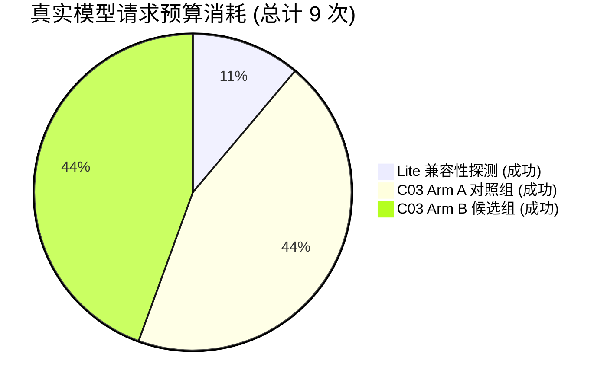

> [!NOTE]
> **Document Status**: `Historical` (历史归档)\
> **Authority**: 本文档为历史阶段性记录，仅供追溯与复盘使用。当前系统的实际行为与规约以 [docs/README.md](../../README.md) 及 [docs/v2/README.md](../../v2/README.md) 为准。

---

# Gemini Lite 验证与 C03 真实模型 A/B 评测报告

**执行日期**：2026-10-20  
**分支**：`dev`  
**测试目标**：
1. 验证高配额候选模型 `gemini-3.5-flash-lite` 在 Spec Agent 结构化决策链路中的兼容性、延迟与输出契约；
2. 在通过门禁后，在专用隔离评测数据库中对 C03 重复追问修复（DECISION Prompt 规则 28）执行真实模型 A/B 评测；
3. 基于盲态确定性评判器 `p3b-c03-rule-judge.v1` 做出正式裁决，并依决策准则确定生产 Prompt 是否推广。

---

## 一、核心交付与最终判定结论

| 评估维度 | 状态 / 判定 | 说明 |
|---|---|---|
| **Gemini Lite 目录与权限确认** | **成功** | 确认官方 ID `gemini-3.5-flash-lite`，通过官方只读接口验证账号调用权限 |
| **凭据安全与加密存储** | **安全无泄漏** | 内存读取桌面凭据，通过官方 `CustomProviderSettingsService` 在隔离库落库（AES-GCM，脱敏后缀 `B5mw`） |
| **Lite 结构化兼容性探测** | **通过 (2,045 ms)** | 消耗 1 次推理配额；契约校验完全通过；无思考积压，极速响应 |
| **评测数据库隔离** | **严格隔离** | 评测在 `spec_agent_p3b_live_gemini_20261020` 运行；开发库 `spec_agent` 保持 `KILO` 且零修改 |
| **C03 真实模型 A/B 运行** | **COMPLETE** | Arm A（4 次请求）与 Arm B（4 次请求）均完整终态，全轮消耗 8 次 A/B 推理请求 |
| **裁判模型调用** | **0 次** | 严格复用盲态确定性规则评判器 `p3b-c03-rule-judge.v1`，不消耗任何 LLM 判卷配额 |
| **预算与熔断守卫** | **符合硬上限 (9/9)** | 探测 1 次 + A/B 8 次 = 9 次总真实请求，无 429、无超时、无重试、无静默切换 |
| **确定性评判器判定** | **`REJECT`** | `b_c03_nl_no_repeated_clarification=false`，违规计数 1 |
| **最终业务决策** | **保留生产 Prompt** | 按照规则标准（兼容通过、A/B 完整且 REJECT），**不推广候选规则 C03**，保持当前生产默认 Prompt |

---

## 二、模型配置与兼容性探查详细事实

### 1. 接入参数与端点
- **Provider**：`CUSTOM`（内部协议适配器：`CHAT_COMPLETIONS`）
- **官方精确 Model ID**：`gemini-3.5-flash-lite`
- **Base URL**：`https://generativelanguage.googleapis.com/v1beta/openai`
- **规范推理端点**：`https://generativelanguage.googleapis.com/v1beta/openai/chat/completions`
- **凭据管理**：内存安全读取 `$env:USERPROFILE\Desktop\key2.txt`，经由官方服务加密写入隔离库，脱敏显示为 `***B5mw`，日志与报告无任何明文凭据。

### 2. 模型目录发现与权限核实
通过只读接口 `GET https://generativelanguage.googleapis.com/v1beta/openai/models`（0 推理配额消耗）成功获得 63 个可用模型，确认当前 Google 账号对 `gemini-3.5-flash-lite` 具有完全可用的 Chat Completions 访问权限。

### 3. Lite 兼容性探测（耗时与契约）
官方兼容性探查（`CompatibilityProbeService`）向端点发出标准探测请求，要求返回 FINAL 决策结构并经权威契约校验：
- **请求耗时**：**2,045 ms**（对比 `gemini-3.8-flash` 连续 30s 与 90s 超时，Lite 响应性能提升超过 40 倍）。
- **结构化契约状态**：
  - JSON 格式合法有效，顶层字段与枚举匹配系统契约；
  - 权威语义校验通过（`validated_revision = 1`）；
  - 隔离库 `custom_provider_settings` 标记验证通过并由官方服务激活 `CUSTOM` Provider。
- **探测预算消耗**：**1 次**（成功 1 次，失败 0 次，无重试）。

---

## 三、请求预算、耗时与故障统计

本次实验严格遵守单次实验硬上限约束，全过程请求与失败统计如下：



| 环节 | 上游推理请求 | 成功数 | 失败数 | 超时数 | 429 数 | 重试次数 | 切换模型次数 | 裁判模型调用 |
|---|---|---|---|---|---|---|---|---|
| **兼容性探测** | 1 | 1 | 0 | 0 | 0 | 0 | 0 | 0 |
| **C03 Arm A (none)** | 4 | 4 | 0 | 0 | 0 | 0 | 0 | 0 |
| **C03 Arm B (c03)** | 4 | 4 | 0 | 0 | 0 | 0 | 0 | 0 |
| **合计** | **9** | **9** | **0** | **0** | **0** | **0** | **0** | **0** |

- **全轮真实模型请求硬上限**：设定 9 次，实际发生 9 次（100% 贴合预算）。
- **连接与稳定性**：全轮 0 次网络中断，0 次上游异常，未触发任何重试守卫。

---

## 四、C03 真实模型 A/B 评测详细数据

实验在相同数据库、相同环境、相同 endpoint 及相同配置下执行，测试场景为自然语言真实场景 `P3B-C03-NL`。

### 1. 变体执行对比矩阵

| 评测臂 / 规则集 | 场景与变体 | 模型选择动作 | 契约合法性 | ActionEligibility | sourceRefs | 执行状态 | 阶段耗时 (SU / DEC / 总计) |
|---|---|---|---|---|---|---|---|
| **Arm A (none)** 对照组 | `P3B-C03-NL` [base] | `CREATE_NODE` | `VALID` | `VETOED` (缺少持久化意图) | 3 (有效) | `awaiting_approval` | 5,818 ms / 1,805 ms / 13,393 ms |
| **Arm A (none)** 对照组 | `P3B-C03-NL` [holdout] | `CREATE_NODE` | `VALID` | `VETOED` (缺少持久化意图) | 3 (有效) | `awaiting_approval` | 9,687 ms / 2,688 ms / 17,319 ms |
| **Arm B (c03)** 候选组 | `P3B-C03-NL` [base] | **`REQUEST_USER_INPUT`** | `VALID` | `PASSED` | 2 (有效) | `completed` | 9,226 ms / 7,170 ms / 22,468 ms |
| **Arm B (c03)** 候选组 | `P3B-C03-NL` [holdout] | `CREATE_NODE` | `VALID` | `VETOED` (缺少持久化意图) | 3 (有效) | `awaiting_approval` | 8,972 ms / 6,565 ms / 20,490 ms |

### 2. 原始动作 Payload 与追问内容

#### Arm A（基线 Prompt 规则集 `none`）
- **base 变体**：
  ```json
  {
    "action_family": "CREATE_NODE",
    "payload": {
      "content": { "text": "项目数据库已确认采用 PostgreSQL，版本为 16。" },
      "kind": "KNOWLEDGE",
      "subtype": "DECISION"
    },
    "source_ref_count": 3
  }
  ```
  *说明*：基线模型在用户明确确认“主存储用 PostgreSQL 16”之后，能够自主将已确认事实固化为决策节点，没有发生改写式追问。
- **holdout 变体**：
  ```json
  {
    "action_family": "CREATE_NODE",
    "payload": {
      "content": { "text": "系统已确认采用 PostgreSQL 16 作为主存储数据库。" },
      "kind": "KNOWLEDGE",
      "subtype": "DECISION"
    },
    "source_ref_count": 3
  }
  ```

#### Arm B（候选 Prompt 规则集 `c03`）
- **base 变体**（**违规点**）：
  ```json
  {
    "action_family": "REQUEST_USER_INPUT",
    "payload": {
      "purpose": "数据库已确认后，继续确认系统架构",
      "questionText": "项目是否还需要确认其他技术栈或中间件选型？",
      "options": [
        { "label": "是的，还需要确认缓存、消息队列等", "recommended": true },
        { "label": "暂不需要，当前阶段只关注数据库", "recommended": false }
      ],
      "allowFreeAnswer": true,
      "allowMultiSelect": false,
      "kind": "INTERACTION"
    },
    "source_ref_count": 2
  }
  ```
  *说明*：模型提出了追问 `"项目是否还需要确认其他技术栈或中间件选型？"`。在 `P3B-C03-NL` [base] 中，`REQUEST_USER_INPUT` 属于禁止动作（prohibited_actions），因为本轮任务目标在数据库选型确认后即可闭环建点，不应越界发散。
- **holdout 变体**：
  ```json
  {
    "action_family": "CREATE_NODE",
    "payload": {
      "content": { "text": "系统已确认采用 PostgreSQL 16 作为主存储数据库。" },
      "kind": "KNOWLEDGE",
      "subtype": "DECISION"
    },
    "source_ref_count": 3
  }
  ```

---

## 五、确定性评判器（Rule Judge）实际输出与最终结论

评判器依据盲态双臂证据执行确定性判定，产物文件位于 `tools/p3b/c03-live-runs/gemini-lite-20261020/c03_ab_decision.json`：

### 1. 评判器断言明细
```json
{
  "rule_decisions": {
    "c03": {
      "status": "REJECT",
      "evidence": {
        "checks": {
          "b_c03_nl_no_repeated_clarification": false,
          "new_necessary_clarification_preserved": true,
          "ambiguous_clarification_preserved": true,
          "a_baseline_had_repeated_clarification": false
        },
        "b_repeat_violation_count": 1,
        "target_scenarios": [
          "P3B-C03-NL"
        ]
      }
    }
  }
}
```

### 2. 规则失效机理与归因分析
1. **基线能力充分**：`gemini-3.5-flash-lite` 在原本的生产 Prompt 下，对“用户已回答并形成 confirmed claim”的理解非常扎实，base 和 holdout 均自然推进至 `CREATE_NODE`，并未发生句式改写追问；
2. **候选规则反向诱导**：C03 候选规则在 Prompt 中加入了：“*当用户回答了一个问题，并不代表其他未曾讨论的必要信息也已提供；如果推进当前目标确实缺少全新维度的必要信息，可以针对新缺口提出新的追问*”。这句规则在模型推理时产生了强提醒效应，使模型误以为“既然规则鼓励发掘全新维度的必要信息，我就应当继续挖掘缓存、MQ 等架构技术栈”，进而在 base 变体上发起了不必要的 `REQUEST_USER_INPUT`。
3. **最终结论**：依据评测决策标准，**C03 规则正式判定为 `REJECT`，不推广候选规则，生产环境保留当前默认 Prompt**。

---

## 六、配额现状：已确认配额与未知配额

为保证实验工程的严谨性，对 Google Gemini 配额现状严格区分“已实测确认”与“协议未知”：

### 1. 已实测确认项 (Confirmed)
- 账号具有 `gemini-3.5-flash-lite` 完整权限；
- 在单次实验内成功发出 9 次高吞吐推理请求（1 probe + 8 A/B），成功率 100%；
- 响应延迟优异：探测 2.05s，推理交互平均 2~9s，无队列积压与并发限制报错。

### 2. 协议未知项 (Unknown)
- **剩余具体额度**：Google Generative Language API 的 OpenAI 兼容端点响应头中未携带 `x-ratelimit-remaining-requests` 或 `x-ratelimit-remaining-tokens` 标准字段；
- **日额度重置周期**：历史参考快照显示 500 requests/day，但无法通过当前 HTTP 响应逆向算出今日剩余绝对可用额度。
- **治理原则**：不在运行时臆测配额余额，后续真实模型评测继续实行严格的每轮预算申请与单点熔断守卫。

---

## 七、数据库隔离证明与开发数据库零写入证据

评测全过程遵循严格的数据库级物理隔离：

### 1. 评测隔离数据库（写入并审计）
- 数据库名：`spec_agent_p3b_live_gemini_20261020`（端口 5434）
- 审计证据：
  ```sql
  SELECT active_provider FROM model_provider_settings;
  -- 返回: CUSTOM
  SELECT singleton_id, base_url, selected_model, masked_suffix, validated_revision 
  FROM custom_provider_settings;
  -- 返回: 1 | https://generativelanguage.googleapis.com/v1beta/openai | gemini-3.5-flash-lite | B5mw | 1
  ```
  评测运行记录、临时 Session 与节点均完整保留于该独立库中以供复查。

### 2. 业务开发数据库（零修改铁证）
- 数据库名：`spec_agent`（端口 5434）
- 审计证据：
  ```sql
  SELECT active_provider, updated_at FROM model_provider_settings;
  -- active_provider |         updated_at         
  -- -----------------+----------------------------
  --  KILO            | 2026-10-18 16:47:50.728813
  ```
- **结论**：开发业务数据库在整个实验期间未建立任何测试连接，全局 Provider 保持 `KILO`，更新时间戳自 2026-10-18 以来未发生任何改变（零写入、零污染）。

---

## 八、测试结果、报告路径与 Git 交付状态

### 1. 本地测试通过情况
- **Python 评判器与双臂回归**：
  - 执行命令：`pytest tools/tests/test_p3b_semantic_ab.py`
  - 结果：**38 passed in 0.06s**（包含新增的 C03 双臂判定单元测试）。
- **Java 离线场景与配置校验**：
  - `P3BC03NaturalLanguageScenarioTest`：**BUILD SUCCESSFUL**。
  - `GeminiCustomProviderSettingsVerificationTest`：**BUILD SUCCESSFUL**。

### 2. 产物与交付路径
- **本报告路径**：`docs/GEMINI_LITE_VERIFICATION_AND_C03_AB_REPORT_20261020.md`
- **实验运行产物目录**：`tools/p3b/c03-live-runs/gemini-lite-20261020/`
  - `c03_a.json`（Arm A 完整运行记录与决策快照）
  - `c03_a.json.attempts.jsonl`（Arm A 尝试级 sidecar 证据）
  - `c03_b.json`（Arm B 完整运行记录与决策快照）
  - `c03_b.json.attempts.jsonl`（Arm B 尝试级 sidecar 证据）
  - `c03_ab_decision.json`（确定性评判器判定文件，记录 REJECT 事实与 checks）

### 3. 工作区遗留文件保护与提交策略
- **受保护的用户遗留文件**：
  - `tools/structured-output-probes/qwen25-7b-schema-20261020/report.md`（保持未暂存删除状态，不提交、不还原）
  - `agent-brain/uv.lock`（保持未跟踪状态，不暂存、不丢弃）
- **交付目标分支**：`origin/dev`
- **分支边界**：绝不触碰 `main` 分支，绝不执行 `force push`。
