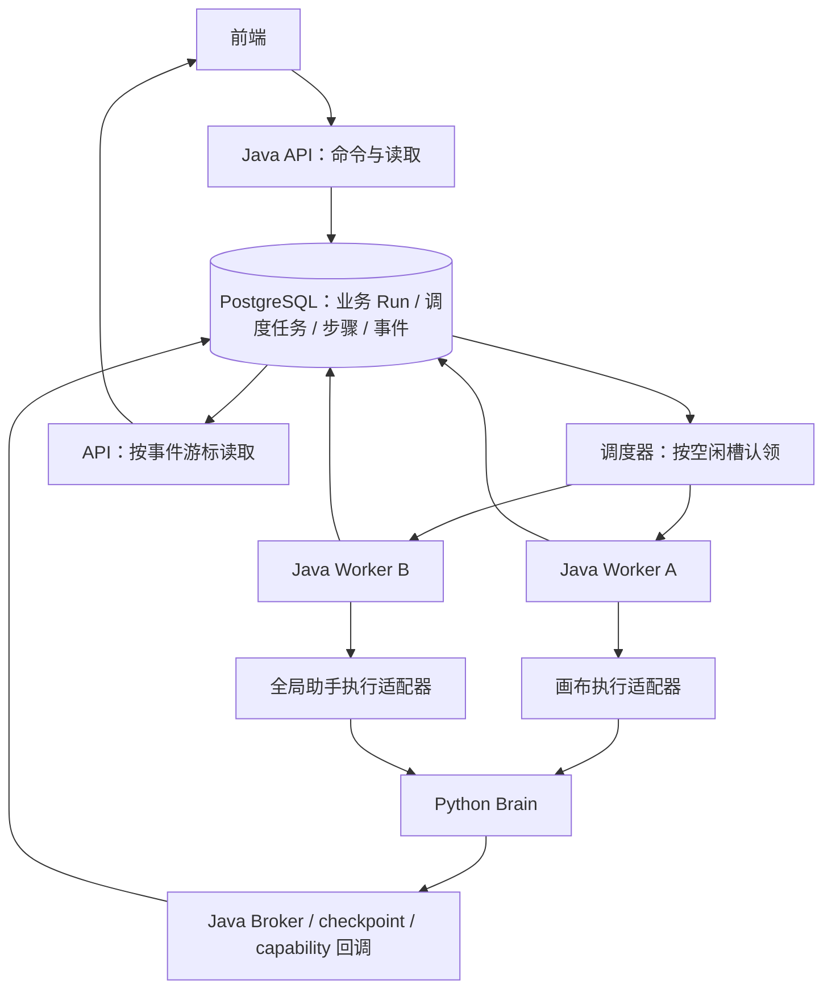

# 第一阶段：多 Worker 执行架构设计

日期：2026-10-11。状态：设计提案，尚未实现，参数为待验证初值。

## 1. 目标与边界

将画布 Agent 和全局助手升级为数据库持久化调度、多 Worker 并行执行、按任务隔离所有权的运行系统。保留 Java Runtime、Python Brain、PostgreSQL，以及现有业务 Run、不可变 Answer、Patch、上下文快照和事件事实源。

第一阶段交付：不同项目/助手会话可并行；同一业务范围有序；进程退出不丢排队任务；可恢复步骤允许接管；无法确定的外部副作用进入明确失败和人工核对；迟到执行不能提交结果。

本阶段只支持受信任内网/本机部署，不因多 Worker 而开放公网入口。身份、组织权限、Redis 共享配额、供应商 RPM/TPM 管理、完整监控平台属于后续阶段。本阶段提供固定全局执行容量和基础调度指标，不承诺具体用户数或生产吞吐。

不增加 MQ、Temporal，不重写 Brain，不把业务 Run 合并成一个通用业务模型。调度生命周期与业务生命周期分离。

## 2. 现状依据

| 代码 | 已有能力与限制 |
|---|---|
| `agent/runtime/ExecutorLease.java` | 全库 advisory lock + 所有权代次，明确只允许一个执行器 |
| `agent/runtime/ExecutionFence.java` | 通过事务内所有权行锁解决旧快照写入竞争；无租约时 epoch=0 的放行只适合原单实例边界 |
| `agent/runtime/RunWorkerPoller.java` / `RunWorker.java` | 轮询中同步认领执行，不同 trigger 按固定顺序处理 |
| `agent/runtime/AgentRunRepository.java` | 已有 `SKIP LOCKED` 原子认领和条件更新 |
| `agent/runtime/AnswerCycleService.java` | 已有 Answer/Patch checkpoint 与修复逻辑，需要逐步骤验证自动恢复安全性 |
| `assistant/api/GlobalAssistantConfig.java` / `runtime/RunDispatcher.java` | 本地有界线程池，任务派发依赖内存；饱和后 Run 失败 |
| `assistant/runtime/GaExecutionPreparation.java` | 冻结输入、模型绑定，execution epoch 固定从 1 初始化 |
| `assistant/runtime/GaExecutionStore.java` | 调用账本、调用预算、epoch/lease 校验；UNKNOWN 调用不自动重发 |
| `agent/runtime/AgentRunOrphanRecoveryService.java` / `assistant/runtime/GlobalAssistantRunRecoveryService.java` | 启动扫描活跃 Run 并终态化，不能直接用于多实例 |
| `agent-brain/.../global_assistant/execution.py` | one-shot 执行、数据库执行认领和进程内活动表；已有 checkpoint 不等于支持跨 attempt 恢复 |

以上为本次只读检查结果。现有工作区还有其他修改，本设计不更改这些文件。

## 3. 目标结构

调度器部署在每个 Worker 进程中，实例间靠数据库协调，无单一 leader。API 与 Worker 第一阶段可以同进程部署，但支持 API-only/Worker-enabled 配置。两个 Worker Java 进程共享数据库和兼容的内部凭证；Brain 可使用共享服务或各实例独立服务。

## 4. 并行边界

1. 画布任务取得 `project:{projectId}` 独占执行范围。第一阶段同项目串行、不同项目并行。项目活动路线、undo/redo 和恢复存在共享状态，目前不足以安全承诺同项目不同路线并行。
2. 全局助手取得 `ga-thread:{threadId}` 独占范围，保留同会话至多一个活跃 Run 与 steer 交接语义。
3. 助手修改已有项目时，需要在实际写入事务中与目标项目范围协调，不在准备 UI 上下文时锁定项目。已有画布任务占用该范围时，工具返回类型化的 BUSY 结果，由当前 Run 结束/后续用户操作处理；本阶段不增加动态等待状态。
4. 助手仅提交异步画布命令时，在同一短事务中创建子 Run 与任务并返回 runId，不持有父任务范围等待子任务结束。
5. 用户编辑、切路线、undo/redo 继续走业务事务锁和版本校验。执行范围不等于禁止用户操作；任务冻结之后发生相关变更，提交时由 stale-context 检查拒绝。
6. 项目删除通过显式取消关联任务、使结果不可再提交、保留审计记录的事务协议处理，不以级联删除调度所有权行作为正常取消手段。

不同助手会话也可能修改同一项目；项目范围协调必须覆盖工具入口，不能只覆盖画布 Worker。

## 5. 数据模型

### 5.1 `runtime_tasks`：新增公共调度表

| 字段 | 含义 |
|---|---|
| `id` | 任务 UUID |
| `family` | WORKSPACE / GLOBAL_ASSISTANT |
| `workspace_run_id` / `ga_run_id` | 恰好一个非空，各自外键到对应业务 Run；每个业务 Run 唯一任务 |
| `task_type` | 对应 trigger 或 GA_EXECUTION |
| `state` | QUEUED / LEASED / RECOVERING / SUCCEEDED / FAILED / CANCELLED |
| `worker_id` | 每次进程启动生成的新 UUID，不能用固定主机名冒充执行身份 |
| `execution_epoch` | 首次认领变为 1；每次撤销旧所有权/新认领单调递增 |
| `lease_id` | 每次认领生成的新随机 UUID |
| `lease_until` / `heartbeat_at` | 数据库时钟管理的租约和最近续租时间 |
| `attempt_count` / `max_attempts` | 有界恢复次数 |
| `available_at` / `created_at` | 可认领时间和排队顺序 |
| `deadline_at` | 首次实际执行时固定的绝对总截止时间，恢复不能重置 |
| `cancel_requested_at` | 取消信号 |
| `input_ref` / `input_version` | 持久化执行输入的引用与版本，不保存凭证 |
| `last_error_code` / `recovery_reason` | 可查询的失败与恢复原因 |
| `protocol_version` | 执行协议版本，用于拒绝不兼容 Worker |

排队索引以 `(family, available_at, created_at, id)` 为起点，仅覆盖 QUEUED；另建过期 LEASED 扫描索引。具体索引通过执行计划与负载验证。

业务 Run 状态继续表达业务进度；恢复只改变调度状态，不把 `CONTEXT_BUILT` 等业务进度重置为 CREATED。任务与 Run 的终态在同一事务更新，不能出现 Run 已完成、任务再次认领。

### 5.2 `runtime_task_scopes`

保存任务需要的范围集合，主键 `(task_id, scope_key)`。范围只能由 Java 根据命令生成，模型不能指定。

### 5.3 `runtime_scope_owners`

`scope_key` 主键，保存 `task_id、execution_epoch、lease_id`。不独立续租，所有权有效性以所属任务为准。任务失效后由恢复事务撤销/转交，不能仅根据 worker 心跳盲目释放。

### 5.4 `runtime_capacity_slots`

预建固定槽位，例如全局 4 个执行槽，另有每类容量上限。槽位保存 task/epoch/lease 绑定。认领任务、占用槽位和业务范围必须原子完成；单机线程池配置不能被当成全局限额。

槽位仅限制当前获授权的执行，不能保证断网旧进程的远端推理立即停止。恢复可能产生短期重复模型计算；供应商硬限额留到共享模型配额阶段。

### 5.5 `runtime_task_attempts` 与步骤记录

attempt 保存每次 epoch、Worker、开始结束和失效原因。新增画布步骤账本 `workspace_run_steps`；GA 复用 `ga_execution_calls` 与 checkpoint，补充恢复元数据和按 attempt 的执行认领/内部事件去重。

画布步骤至少保存：`run_id、step_key、input_hash、state、origin_epoch、result_ref、retry_class`。唯一键为 `(run_id, step_key)`，重试输入不一致时拒绝复用。步骤身份不包含 attempt，避免每次接管都被识别成新副作用。

步骤状态：PREPARED / IN_FLIGHT / SUCCEEDED / UNKNOWN / FAILED。`SUCCEEDED` 必须有可验证结果引用。调度器没有第二份业务结果事实源。

## 6. 核心事务协议

### 6.1 入队

在现有命令事务内完成：幂等检查、保存业务 Run 与执行参数、插入 runtime_tasks 与 scopes、写创建事件。全局助手当前依赖 dispatch 参数传递的 message/UI context 必须持久化后再应答。

进程内通知只能加速唤醒，数据库轮询负责兜底。事务提交后立即崩溃也不能丢任务。队列达到持久化容量上限时，在创建 Run 前拒绝并返回可重试错误；线程池暂时忙时任务保持 QUEUED。

### 6.2 认领

1. 先保留本进程一个实际空闲执行槽，没有空闲槽则不认领。
2. 事务中用 `FOR UPDATE SKIP LOCKED` 选候选 task，排序 `(available_at, created_at, id)`；检查兼容版本、取消和总截止时间。
3. 按固定顺序取得数据库容量槽与所有业务范围；范围有存活占用者则回滚候选认领，扫描其他候选，不等待它跑完。
4. task 更新为 LEASED、写 worker/epoch/lease/租约，绑定容量和范围，记录 attempt；首次执行同时推进业务 Run 到运行态。全部一次提交。
5. 提交后再进入执行器，不在数据库事务内发 HTTP。
6. 本地提交执行器失败时，由该 token 条件释放认领并重新排队；不盲目标记业务失败。

每次扫描有界，避免同一个繁忙项目挡住其他项目；两类队列默认轮换认领，各有最低可用容量，避免一种长任务占满系统。候选扫描上限和轮换策略需要饥饿测试。

### 6.3 锁顺序与写入保护

所有执行、取消、接管与终态事务统一顺序：task 行 → 容量槽（按键排序）→ scope 行（按键排序）→ 业务 Run → 项目/会话与业务行。没有涉及的锁可以跳过；尝试工具范围时若冲突立即返回，不在持有会话锁时等待另一任务释放范围。

受保护写入先 `SELECT task ... FOR UPDATE`，取锁后验证 task.state=LEASED、worker/epoch/lease 匹配、租约与 deadline 未到期、未取消，再在同一事务写业务结果和 checkpoint。接管也锁同一个 task 行，建立提交互斥，不能只用普通 SELECT 或跨表子查询快照比较。

旧事务若先取到锁且验证通过，可以先提交；接管必须等它提交后读取最新结果。接管若先提交，旧事务验证失败并整体回滚。数据库事务保持短且有锁等待/语句超时；租约到期本身不强行回滚一个已获授权的短事务。

不允许生产执行以 epoch=0 或缺少 token 绕过校验。API-only 的用户命令可正常工作，但不能调用受保护的执行提交入口。执行 token 显式传入 Java/Python/RPC，不把线程局部变量作为唯一传递机制。

特别注意：现有失败服务使用 REQUIRES_NEW。task 使用排他行锁后，外层持锁再调用内层失败事务会自等待。执行事务先结束/回滚，再调用带 token 的独立失败事务；需要原子失败的场景则在当前事务提交，不保留旧调用结构。

### 6.4 心跳

独立有界心跳执行器，不使用执行模型调用的线程池。条件续租要求 token 匹配、LEASED、未取消、旧租约仍有效；过期租约不能复活。使用数据库时钟。deadline 不因续租增加。

续租失败后立即停止发起新步骤，并尽力取消 HTTP/Python 执行；所有提交/RPC 仍以数据库验证为最终权威。可在数据库不可达时提前终止执行，不在网络恢复后自作主张沿用旧 token。

### 6.5 完成与取消

完成事务原子写：最终业务结果、Run 终态、终态事件、task 终态、attempt 结束、释放所有容量与范围。重复终态请求读取既有结果，不追加第二次终态。

取消由控制面锁 task 后撤销当前 token、写取消状态、按业务规则处理 Run 和事件、释放容量范围。正在进行的模型/工具调用只能尽力停止，已提交事实与已发生外部副作用不能宣称已撤销。

GA 保留 CANCELLED；画布当前只有 COMPLETED/FAILED 两种终态，本阶段取消映射为 FAILED + 专用取消原因，并在前端明确展示。若要新增 CANCELLED 枚举，另行进行完整契约迁移。

GA steer 路径需要调整 `thread → run` 的现有锁顺序，接入上述 task 所有权协调。继任 Run、用户消息、pending turn 消费与调度任务同事务创建；不依赖本地 terminal event listener 才能派发。

## 7. 过期恢复与步骤安全

多个实例周期扫描过期 LEASED，用 SKIP LOCKED 分批处理。锁 task 后再次核实过期，撤销旧 token、标记旧 attempt 结束，并进入 RECOVERING。恢复不依赖 worker 是否已从注册表消失。

恢复检查只访问持久化数据，保持短事务：取消/截止/超过尝试数直接终态化；核对业务 Run、步骤结果和调用账本；安全时转 QUEUED 并设置 available_at；不安全时 FAILED + `EXECUTION_OUTCOME_UNKNOWN` 并提供核对记录。

| 步骤/故障点 | 恢复策略 |
|---|---|
| 入队后尚未执行 | 原任务直接认领，不重建 Run |
| Answer 已提交 | 复用 Answer ID，校验内容/来源，不创建第二个 Answer |
| Patch/checkpoint 已提交 | 复用经过核验的补丁，继续下一步 |
| 模型结果已完整持久化 | 校验输入 hash、协议版本，复用结果 |
| 模型已发出但结果未保存 | 可配置重新推理，承认可能重复计费；只限无业务副作用模型步骤 |
| 本地数据库工具 | 工具结果和业务副作用同事务提交；查账本后复用，未提交则按幂等协议重试 |
| 外部有副作用工具 IN_FLIGHT/UNKNOWN | 默认不重放；有供应商幂等键/查询回执且适配器验证通过才允许恢复 |
| 完成已提交但响应丢失 | 返回原终态与事件，不再生成结果 |

只有提供 RecoveryAdapter 且通过故障测试的 task_type 可以自动恢复，其余使用租约过期后的诚实失败。第一阶段结束至少支持一条画布 Answer/Patch 链的安全接管；不能只完成多 Worker 就称恢复完成。

GA 分两步：先持久化排队 + 多会话并行 + 按租约诚实终态化，再开放经过验证的恢复。需要去掉 epoch=1 的硬编码，按 attempt 管理 executor_claimed、事件序号/去重，并验证 LangGraph checkpoint 的 pending writes 与调用账本一致性。不得把旧 RESERVED 自动删除或重置调用预算；恢复沿用原模型/能力快照和剩余预算。

执行绝对 deadline 与租约分开。GA 目前最长 180 秒预算保持；恢复不能重新得到 180 秒。画布有多个模型步骤，初值总 deadline 15 分钟，最后依据测量调整。

## 8. Python、回调与多实例事件

- 画布 Brain 请求和 GA 请求、checkpoint、模型/工具 RPC 都携带 task/epoch/lease 绑定；新旧协议兼容必须显式版本化，不默认允许旧请求。
- GA 回调可以经固定内部服务入口到任意 Java 实例，实例从数据库验证执行 token，不依赖某个 Java 进程的内存。内部地址来自部署配置，不接受模型指定地址。
- Python 进程内 active 表只用于协作取消和清理。跨 epoch 的旧请求即使仍在运行也无法使用 Broker 或提交 checkpoint。新 epoch 的活动标识按 run+epoch+lease 区分。
- Java 全局执行容量与 Python 实际承载需匹配。Python 提供有界接入，拒绝过载；后端按是否已发生执行认领/外部调用决定重排或失败，不能无条件重发 launch。
- 复用现有持久化事件，API 用游标读取数据库补发。跨实例 SSE 不依赖进程内 publisher；短轮询为第一阶段兜底，每次读有限数量并遵守终态/游标语义。
- 公共事件序号跨 attempt 连续；内部流序号按 attempt 分区。旧 attempt 的 delta、终态、checkpoint 均拒绝。接管后复用完整消息或发明确的 attempt 重置事件，不能把两次推理的文本直接拼接。
- 断连不取消任务，SSE 会话数不消耗模型执行槽。

## 9. 建议初值与可观测性

初值：每 Worker 本地执行槽 2，全局容量 4；两类任务各上限 2。租约 60 秒、每 10 秒续租；认领轮询 500ms 加随机抖动；过期扫描 5 秒；最多 3 个 attempt；总排队上限 1000、每范围上限 20。均为配置项和实验初值。

排队容量检查必须有数据库级串行化或配额计数保护，不能 COUNT 后无锁插入。实验中每个数据库短事务设置合适的超时，并通过连接池容量保证心跳/提交/回调不被执行线程挤死。

提供基本指标/日志：queued、leased、可用槽位、队列最老等待时间、按 task_type 的等待/执行耗时、续租失败、接管次数、迟到写入拒绝、UNKNOWN 调用。日志包括 taskId/runId/workerId/epoch/attempt，避免正文和凭证。

Worker readiness 反映认领与心跳是否正常；API-only readiness 不因为本进程无 Worker 就失败。另提供数据库范围内的执行可用性状态；没有可用 Worker 时按入队策略明确提示，不将已入队任务静默标记完成。

## 10. 模块与改造落点

建议新增 `com.specagent.runtime.execution`，仅依赖公共基础设施和自己定义的端口；不直接引用画布/助手业务服务。由各业务包实现 TaskExecutionAdapter、RecoveryAdapter、TaskTerminalizationPort 等接口，保持现有 ArchUnit 无环约束。

| 当前模块 | 改造 |
|---|---|
| ExecutorLease / ExecutionFence | 最终替换为任务级 ExecutionToken 与 TaskWriteGuard；删除生产 epoch=0 放行 |
| AgentRunRepository / AgentRunService | 保留业务状态；认领迁入公共任务仓储，写入统一受 token 保护 |
| RunWorkerPoller / RunWorker | 按空闲槽调度，适配器执行；错误与丢失所有权分开处理 |
| AnswerCycle / Artifact / Decision 等 | 显式 token 传递，步骤结果与 checkpoint 原子提交，按类型提供恢复适配器 |
| RunDispatcher / GlobalAssistantConfig | dispatch 改成持久化入队/唤醒；线程池成为公共执行池配置 |
| GaExecutionPreparation / Store / Completion | 接入任务护栏、动态 epoch、attempt 事件与安全恢复入口 |
| 两套 OrphanRecovery / WorkerPollingGate | 替换为过期租约恢复；启动不终止其他实例活跃 Run |
| TurnHandoff / continuation checks | 同事务持久化继任任务；后台检查使用 SKIP LOCKED + 幂等，避免双重续跑 |
| Python execution / checkpoint RPC | 协议版本升级、attempt 标识与取消清理；维持 Java 事实所有权 |
| Health / SSE | 区分 API 与 Worker 健康，跨实例数据库游标读取 |

## 11. 实施顺序与发布

1. **P1-A：执行入口清单与协议冻结。** 枚举所有认领、checkpoint、失败、人工接受 proposal、续跑、恢复、工具写入、取消入口；确认 token 保护覆盖和锁顺序。新增表/协议/适配器骨架，仍保持单 Worker。
2. **P1-B：画布调度与事务护栏。** 入队原子性、执行槽、范围所有权、心跳、终态、取消、陈旧上下文检查；替换 failure REQUIRES_NEW 调用结构。单实例并发验证后开放两个 Worker。
3. **P1-C：画布安全恢复。** 先实现 Answer/Patch 链步骤账本与故障恢复；其他类型逐个开放，未验证类型诚实失败。
4. **P1-D：全局助手接入。** 持久化 dispatch 参数、steer/继任任务事务、token RPC、事件按 attempt 去重、断线重连；先验证多会话并行和安全失败，再实现通过验证的 checkpoint 恢复。
5. **P1-E：双实例与故障验收。** 跨实例回调/SSE、调度公平性、容量边界、数据库中断、关闭退出与迁移演练。更新交付文档，不提前宣称企业认证或供应商全局限流完成。

首发采用维护窗口：停止新入队、让现有执行收敛、备份数据库、停止全部旧 Java/Python 执行进程、迁移未执行任务、部署兼容版本后开放。遗留中断任务用旧政策诚实失败，历史终态不重写。

禁止新旧调度器混跑：旧实例不理解 task token，会破坏新所有权。不能只关闭 startup-recovery 就宣称混跑安全。协议版本不兼容时 Worker 启动/认领失败。

回退在执行 drain 后进行；已出现新恢复历史时，不直接降级旧二进制处理活跃任务。保留新表历史，采用前向修复或从经过验证的备份恢复，必须说明可能的数据回退。

优雅退出：停止认领，继续心跳，允许短时间 drain；到退出上限后停止续租和新调用，尽力取消远端，留给新 Worker 按账本恢复。不能退出时把所有排队任务标记失败。

## 12. 验收标准

使用真实 PostgreSQL + 两个独立 Java 进程进行协议验收，模型使用可控制延迟/故障的 stub。真实模型只做有限烟测，避免供应商抖动掩盖调度行为。

| 场景 | 必须满足 |
|---|---|
| 同一个 Run 被同时认领 | 只有一个有效 token；同一业务结果和终态事件至多提交一次 |
| 四个不同项目慢任务 | 在配置全局容量 4 下可重叠执行；第五个排队，本地无无界 backlog |
| 同项目多任务/跨会话项目写入 | 同项目任务有序；工具冲突可解释；不同项目仍能继续 |
| 新 Worker 启动 | 不终止其他 Worker 活跃任务；排队任务不丢 |
| 认领后/Answer 后/Patch 后 kill 进程 | 租约到期接管；不重复 Answer/Patch；从核验 checkpoint 继续 |
| 旧 Worker 暂停超过租约后恢复 | 新 token 接管后，旧结果/失败/事件/RPC 一律拒绝 |
| 旧事务等待业务行锁期间发生接管 | 新旧提交按 task 行锁串行；不存在旧快照越过新 token 的写入 |
| 失败事务、心跳、取消竞争 | 无 REQUIRES_NEW 自等待；终态不被覆写；过期租约不被续活 |
| 工具执行后响应丢失 | UNKNOWN 默认停止，审计可查，不自动重复副作用 |
| GA 接管 | 原输入/预算不重置；模型/tool call 账本一致；旧 attempt 流不能拼入新结果 |
| API A 接请求，Worker B 执行，API C 读事件 | 跨实例回调可用；游标无遗漏；重复读取可去重 |
| 模型变慢/执行槽满/持续混合入队 | 心跳正常，排队有上限，两类任务及冷项目不长期饥饿 |
| 数据库短时中断 | 停止新调用，拒绝未授权提交，恢复后重新认领而非复活旧租约 |
| 用户切路线/撤销/删除项目 | 过期结果不能落库，已持久化历史不被任务重试覆盖 |
| 发布/回退演练 | 旧调度器不能混跑，未执行任务可迁移，历史事实保留 |

“有效 token 下的业务结果至多一次提交”不等于“模型和外部工具只执行一次”。容量数字只有测量后才能成为交付承诺。

## 13. 第一批实现范围

先完成 P1-A/P1-B：公共任务表和容量/范围所有权、画布持久化入队、双 Worker 认领、显式 token、事务护栏、心跳、过期诚实失败、终态与基本事件读取。随后 P1-C 才开放安全接管，P1-D 纳入全局助手。

这一分批顺序便于每批复核协议，避免在没有事务保护时同时改写两套执行链。阶段一最终验收以两条链接入和至少一条验证过的恢复链为准，不能把第一批完成当作整个阶段完成。
